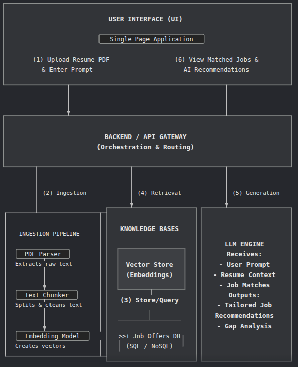

# ARCHITECTURE

## System overview

## Data Flow Breakdown

1. User Action (UI): The user uploads a resume (PDF) and submits a query (e.g., "Find senior backend roles that match my experience") through the SPA.
2. Ingestion & Transformation:
   • PDF Parser: Extracts raw text from the uploaded resume.
   • Chunker: Breaks the resume into logical sections (e.g., Skills, Experience, Education).
   • Embedding Model: Converts those text chunks into numerical vectors.
3. Storage & Indexing:
   • The resume vectors are saved into the Vector Store.
   • (Note: Job descriptions from the Job Offers Database are also pre-embedded and stored in the Vector Store to allow similarity searches).
4. Retrieval (RAG): The backend queries the Vector Store to find job offers semantically similar to the user's resume vectors, pulling full job metadata (salary, location, apply link) from the Job Offers Database.
5. Augmented Generation: The backend sends a combined prompt to the LLM containing the user's request, their parsed resume context, and the retrieved job offers.
6. Response (UI): The LLM generates a tailored response (ranking the jobs and explaining why they fit), which the SPA renders dynamically without reloading the page.

## Software architecture
The application is built in layers. Each layer has its own responsibilities.
- Controller: API's for handling and retrieving data.
- Model: Entities layer
- DTOs: Data transfer objects layer
- Service: implements business logic and other features
- Repository: data access layer